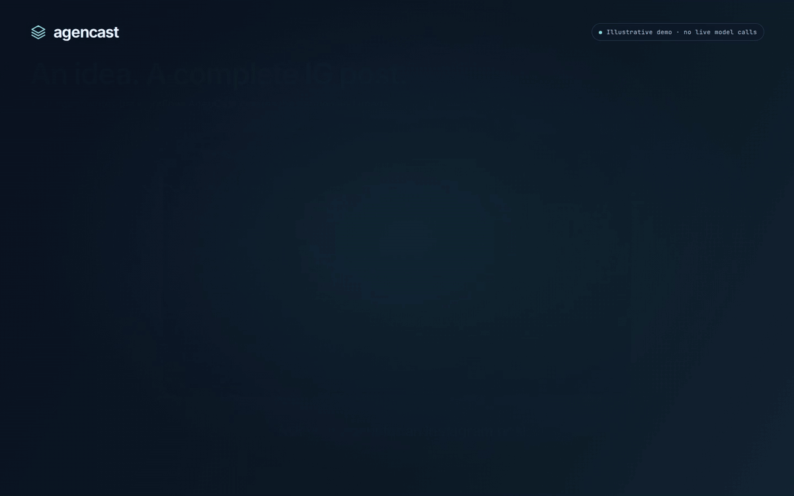
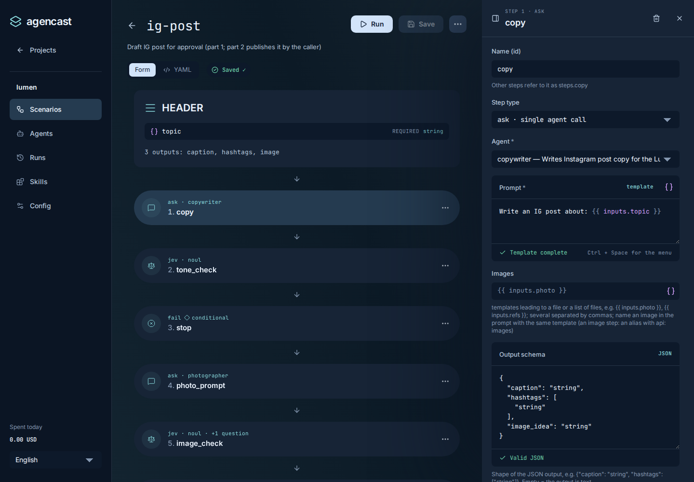

# AgenCast

[](https://github.com/rychidesign/agencast/actions/workflows/ci.yml)

**Turn agent tasks into repeatable workflows.**

AgenCast is an open-source workflow runtime for AI agents. Let your agent write, validate and run reusable
LLM workflows through MCP or the CLI, then inspect the results of every run.

It is for people and small teams who already use AI agents and want to reuse a working procedure with new
inputs. Scenarios are YAML; agents and skills are Markdown. These files keep the procedure between
conversations, so it can be shared, versioned and reviewed.

The project owner sets the models, tool permissions and limits. The optional GUI helps people review and
edit the same files and inspect run records.

[](https://rychidesign.github.io/agencast/)

[Watch the workflow demo](https://rychidesign.github.io/agencast/) · [Watch the video](https://rychidesign.github.io/agencast/agent-workflow-camera.mp4) · [Animation sources and exports](docs/marketing/)

*Illustrative workflow with scripted replies and simulated costs; no live model calls.*

## Why AgenCast

- **Your agent can operate the whole cycle.** Through MCP it can discover scenarios, read the guide, validate
  drafts, write agents and workflows with `--allow edit`, start runs and read their results. The CLI and
  bundled skills support the same work from a terminal.
- **Keep the procedure for the next task.** A scenario makes the steps, branches and calls explicit. Models
  work inside those steps; you can review the procedure and reuse it with new inputs. Live model answers may vary.
- **Check the flow before live model calls.** `validate` checks the files, `--dry-run` shows the plan and
  `--fake` exercises the workflow with scripted model answers. Fixtures also serve as regression tests.
  Fake runs make no paid model calls and record simulated costs for testing; MCP tools and callbacks still run for real.
- **Understand every run.** The run folder keeps prompts, responses, tool calls, errors, a timeline and model
  costs, plus `summary.md` and a standalone `report.html`. Agents can read the results through MCP; people
  can inspect the files or use the GUI.
- **The owner sets the boundaries.** Tool permissions, model aliases, spending checks and timeouts belong to
  the project owner; a scenario can only narrow an agent's permissions and limits. Step and run budget checks
  prevent new model calls once the limit is reached, but an in-flight call can finish over budget — one per parallel
  branch. See [budget behavior](docs/spec/scenario.md#budget). Secrets are referenced by name and masked in records.
- **Fit into existing automation.** MCP, the CLI and a webhook API with signed callbacks let an agent or an
  automation tool start work and collect results. Workflow files and run folders hold the state; the GUI
  provides a human view of it.

## Quick start

Tested on Linux, macOS and WSL with Python 3.12 and `uv`; native Windows is unsupported.
The example below needs no workflow model key and makes no workflow model calls.

```bash
uv tool install agencast
agencast new project ~/agencast-demo --example showcase
cd ~/agencast-demo
```

For Claude Code, connect the prepared project over MCP:

```bash
claude mcp add --transport stdio agencast -- \
  agencast --project ~/agencast-demo mcp --allow edit --fake ~/agencast-demo/fake/ig-post.yaml
```

Then ask your agent:

> Use AgenCast to find the ig-post scenario, validate it, check its plan and run it for the topic
> "coffee" with fake_run. Return the outputs, model cost and run summary.

The server allows workflow editing and uses the shipped fixture for the example. It exposes no live model
run tool. The example's `ig-post` workflow has no MCP task or callback, so it runs offline. Your coding
agent's own usage is separate from the workflow's model cost.

The fake run records simulated model costs to exercise budget checks; these are not charges.

Other MCP clients can start the same `agencast` command over stdio.
[Client configuration and remote servers](#use-from-an-mcp-client) are below;
[the getting started guide](docs/getting-started.md) covers creation, permissions and live runs.

You can also check and run the same workflow from a terminal:

```bash
cd ~/agencast-demo
agencast validate ig-post --offline
agencast run ig-post -i topic="coffee" --dry-run --fake fake/ig-post.yaml
agencast run ig-post -i topic="coffee" --fake fake/ig-post.yaml
```

To let a coding agent work through the CLI, install the bundled skills with `agencast skills install`.
For your own recurring task, have the agent create a scenario, validate it and test the flow before a live
run. Models executing workflow steps currently use OpenRouter; the connected coding agent operates the runtime.

## What it does

- Scenarios in YAML, agents and skills in Markdown.
- MCP and CLI interfaces for creating, checking and running workflows and reading results.
- Model aliases configured by the owner, with workflow model calls through OpenRouter.
- Ten step types: `ask`, `task`, `jev`, `image`, `parallel`, `switch`, `call`, `set`, `fail` and `output`.
- `task` calls permitted MCP tools; `parallel`, `switch` and `call` compose branches and scenarios.
- Images as inputs: `file` and `files` inputs (PNG, JPEG, WebP, GIF, AVIF) come from the CLI, the API, the GUI or an MCP
  client (from a directory the owner allows with `agencast mcp --input-dir`);
  `ask` and `task` can look at them, `image` can edit one or compose a new one from several.
- Permissions belong to the project owner: MCP servers are set only in `workflows/mcp.yaml` on disk —
  the API and the GUI cannot change them.
- A fake provider replaces model calls with no cost and no key; MCP and callbacks stay real.
- Every run stores `summary.md`, `callback.json` and a standalone `report.html`.
- `agencast serve` accepts webhooks and can serve the optional GUI for registered projects.
- `agencast mcp` is an MCP server: Claude Code, Claude Desktop, Open WebUI or another agent can list, run and
  build scenarios through it.
- Skills for coding agents help both run and create scenarios.

## Installation

Verified on Linux, macOS and WSL with Python 3.12; use `uv`.
Native Windows is not supported (`fcntl` in `projects.py` and `task.py`).

From PyPI, install the CLI, MCP server, API and the built GUI together with the bundled documentation,
examples and skills:

```bash
uv tool install agencast
```

Update with `uv tool upgrade agencast`; symlinked skills follow the update.

The sample filesystem MCP server runs via `npx` and needs Node.js `^20.19.0 || >=22.12.0` (verified with Node 24).
To develop AgenCast itself, install from a clone; building the GUI needs the same Node.js:

```bash
git clone https://github.com/rychidesign/agencast
cd agencast
(cd ui && npm install && npm run build)   # builds the GUI into the package
uv tool install --editable framework
```

## Getting started

The whole procedure for the package and for a clone: [Getting started with AgenCast](docs/getting-started.md).

`--fake` replaces only model calls: no model cost and no OpenRouter key.
A `task` step still runs the real MCP servers from `mcp.yaml`; the example
`filesystem` uses `npx`, needs Node.js and downloads a package on first run.
`--callback-url` sends a real callback (and needs its signing secret).
Only scenarios without `task` (including called scenarios)
and without `--callback-url` are guaranteed to run offline, for example `ig-post`.

You can run the `ig-post` example from a clone offline (it has no `task`; do not add `--callback-url`):

```bash
agencast --project examples/showcase run ig-post -i topic="new coffee" --fake examples/showcase/fake/ig-post.yaml
```

More examples are in [examples/](examples/). For your own work, create a project, add your OpenRouter key to `.env` and go through the checks without a live call first:

```bash
agencast new project ~/my-project
cd ~/my-project
cp .env.example .env
# Set OPENROUTER_API_KEY in .env.
agencast validate demo
agencast run demo --dry-run
agencast run demo --fake
agencast run demo
```

## Use from an MCP client

`agencast mcp` serves the registered projects (one with `--project`) to an MCP client: it lists projects and
scenarios, runs them, reads results and, with `--allow edit`, writes scenarios, agents and skills. A run started
through it executes in a process of its own and goes on when the client disconnects or the server restarts.
Everything below is specified in [the MCP server specification](docs/spec/mcp-server.md).

Claude Code starts the server itself (stdio):

```bash
claude mcp add --transport stdio agencast -- agencast mcp           # dry, fake and live runs (--allow run)
claude mcp add --transport stdio agencast -- agencast mcp --fake    # no live model calls; MCP tools stay real
```

In a client that renders MCP Apps (Claude Desktop; Codex Desktop implements the extension too), starting a run also shows a **run card** in the
chat, in the AgenCast look, that follows the run on its own: an animated segmented progress bar, the steps with
their type icons, elapsed time and cost, and at the end the outputs with inline images. It changes nothing for
other clients. Open WebUI renders it through the community
[MCP App Bridge](https://github.com/Classic298/open-webui-plugins/tree/main/mcp-app-bridge) tool (Open WebUI
0.11.4), configured with the server URL and the bearer token; the model then starts runs through its
`call_mcp_tool`.

Claude Desktop starts stdio servers only (`claude_desktop_config.json`, absolute paths, restart the app); on
another machine it starts the server over ssh — no token and no open port:

```json
{"mcpServers": {"agencast": {"command": "/home/me/.local/bin/agencast", "args": ["mcp"]},
                "agencast-box": {"command": "ssh", "args": ["-T", "box", "/home/me/.local/bin/agencast", "mcp"]}}}
```

Clients on other machines or in containers use streamable HTTP: `agencast mcp --http` serves
`http://127.0.0.1:8765/mcp` (`--host`, `--port`) and needs a bearer token of at least 32 characters
(`openssl rand -hex 32`), read from `AGENCAST_MCP_TOKEN` at start. Claude Code takes the URL from `.mcp.json`
and expands `${AGENCAST_MCP_TOKEN}` from its own environment, so the token is in no file:

```json
{"mcpServers": {"agencast": {"type": "http", "url": "http://127.0.0.1:8765/mcp",
                             "headers": {"Authorization": "Bearer ${AGENCAST_MCP_TOKEN}"}}}}
```

```bash
claude mcp add --transport http --scope user agencast http://127.0.0.1:8765/mcp \
  --header 'Authorization: Bearer ${AGENCAST_MCP_TOKEN}'                       # single quotes: stored unexpanded
```

Never let the shell expand the token into a `claude mcp add` command: it would stay in plain text in Claude
Code's configuration and the shell history.

**Images as inputs from another machine.** A tool call carries no bytes, so an image input is a file on the
server's machine inside a directory the owner allows with `--input-dir DIR`. Claude Code or Codex on your laptop
copies the user's images there over your own ssh login first: `list_projects` tells the agent the host, the
user and the directories, and the `agencast-run` skill gives it the recipe (one `mktemp` subfolder per job,
files checked by content, removed again after the run has started). On the laptop:

```bash
ssh box mkdir -p /home/me/agencast-inputs     # the directory must exist on box before the server starts
claude mcp add --transport stdio agencast -- ssh -T box /home/me/.local/bin/agencast mcp --input-dir /home/me/agencast-inputs
uv tool install agencast && agencast skills install
```

Then "here are the photos in ~/Desktop/ig, make an Instagram post with the scenario product-post" is enough —
for a scenario whose `photos` input has the type `files`.

In Open WebUI (0.6.31 or newer), add an external tool server of type
MCP (Streamable HTTP) with the URL and Bearer authentication with the token. Open WebUI in Docker reaches
`http://127.0.0.1:8765/mcp` with `--network=host`; otherwise start the container with
`--add-host=host.docker.internal:host-gateway`, the server with `agencast mcp --http --host 172.17.0.1 --allow-host host.docker.internal`
(the Docker bridge) and use `http://host.docker.internal:8765/mcp`.

The HTTP server as a systemd user service, `~/.config/systemd/user/agencast-mcp.service`:

```ini
[Unit]
Description=AgenCast MCP server (streamable HTTP)

[Service]
# Only AGENCAST_MCP_* in this file (mode 600), no provider keys: a key set here wins over
# every project's .env and pays for the runs of all projects.
EnvironmentFile=%h/.config/agencast/mcp.env
ExecStart=%h/.local/bin/agencast mcp --http --allow run
# Runs are processes of this unit: without this line a stop or restart interrupts them.
KillMode=process
Restart=on-failure
RestartSec=5

[Install]
WantedBy=default.target
```

```bash
(umask 077; mkdir -p ~/.config/agencast && printf 'AGENCAST_MCP_TOKEN=%s\n' "$(openssl rand -hex 32)" > ~/.config/agencast/mcp.env)
systemctl --user daemon-reload && systemctl --user enable --now agencast-mcp
loginctl enable-linger "$USER"                  # the service and its runs outlive your logins
tailscale serve --bg 8765                       # https://box.<tailnet>.ts.net/mcp for the tailnet
```

Behind `tailscale serve` add `--allow-host box.<tailnet>.ts.net` to `ExecStart` (the name clients use; without it
they get 421), and point `.mcp.json` at `https://box.<tailnet>.ts.net/mcp`.

On macOS the same server runs as a launchd agent with the same `mcp.env`
(`~/Library/LaunchAgents/agencast-mcp.plist`): the plist and its `launchctl` commands are in
[docs/spec/mcp-server.md](docs/spec/mcp-server.md#as-a-launchd-agent-macos).

Expose the server only on a private network: it speaks plain HTTP, so keep `127.0.0.1` and publish it with
`tailscale serve` (never `tailscale funnel`). Whoever has the token has the server's level; `--fake` stops model
spending but `task` steps still start their MCP servers — only `--allow read` starts nothing. Runs end only when
their own process is stopped: a signal to it, or the end of the control group it lives in (a unit without
`KillMode=process`, a stopped container, a logout without lingering).

## Skills for coding agents

`agencast skills install` installs the skills for the Claude Code, Codex,
OpenCode and OMP tools it finds; `--to all` selects all of them. More: [skills/](skills/).

## Repository structure

| Path | Contents |
|---|---|
| `framework/` | Python package and the `agencast` command |
| `ui/` | GUI source code |
| `examples/` | Standalone showcase and tutorial projects |
| `docs/` | Specification, design and tutorials |
| `skills/` | Skills for coding agents |

## Documentation

- [Format specification](docs/spec/)
- [Tutorials](docs/tutorials/)
- [Framework design](docs/DESIGN.md)
- [Runtime reference](framework/README.md)
- [GUI README](ui/README.md)
- [Skills for coding agents](skills/)

## GUI and server

The GUI is an optional interface for people to review and edit workflow files and inspect runs.
Agents use MCP or the CLI to operate the same runtime. `agencast serve` serves the GUI bundled with the
package (in a clone, after the GUI build described in [Installation](#installation)).



`agencast serve` can run in project registry mode. On the host, set
`AGENCAST_TOKEN`, `AGENCAST_HOST` and `AGENCAST_PORT` in
`~/.config/agencast/serve.env` (systemd `EnvironmentFile`; on macOS the launchd agent's shell reads it). Expose the GUI
only on a private network. You can find the address by reading only the host and port:

```bash
grep -E '^AGENCAST_(HOST|PORT)=' ~/.config/agencast/serve.env
```

Never print the token value.

The GUI shows MCP servers read-only: `workflows/mcp.yaml` is edited by the project owner on the server,
the API neither reads nor writes it. A project added or created through the GUI or the API uses no MCP
server until its owner allows it in a terminal:

```bash
agencast projects trust <name>
```

The GUI is English by default. The Czech translation is in `ui/src/locales/cs.json`;
choose the language in the GUI.

## Status and license

The current runtime version is **0.19.4** (the 0.19.x line); the history of changes is in
the [changelog](framework/CHANGELOG.md). The project is available under the
[WTFPL version 2](LICENSE) license.

This program comes without any warranty, to the extent permitted by applicable law.

[Contributing](CONTRIBUTING.md) · [Security](SECURITY.md)
